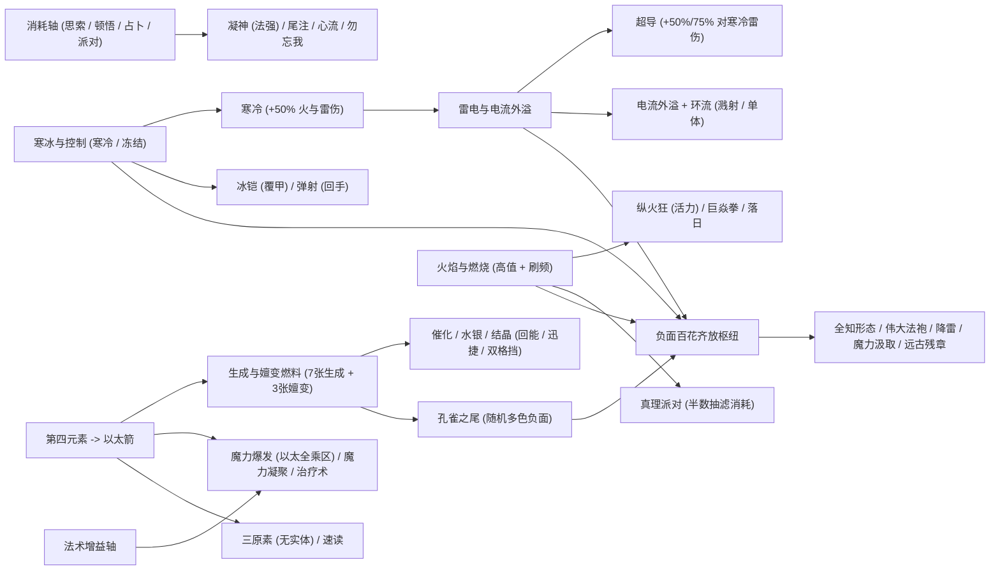

# 二、已有卡牌体系关系、耦合度、强度与设计感审计

> **方法说明**：本篇所有机制判定、乘区叠加与“生产者—消费者”统计均经过代码级核验（含剥离注释后的精确引用分析，参见 [SpellProps.cs](file:///D:/Projects/STS2/Wizard/src/Scripts/Spells/SpellProps.cs)、[BurnPower.cs](file:///D:/Projects/STS2/Wizard/src/Scripts/Powers/BurnPower.cs)、[MagusRobePower.cs](file:///D:/Projects/STS2/Wizard/src/Scripts/Powers/MagusRobePower.cs)、[OmniscientFormPower.cs](file:///D:/Projects/STS2/Wizard/src/Scripts/Powers/OmniscientFormPower.cs)、[ManaBurst.cs](file:///D:/Projects/STS2/Wizard/src/Scripts/Cards/ManaBurst.cs) 等核心源码）。

---

## 2.1 七大明线体系与两大微轴全景

巫师的卡池设计并非孤立的“火/雷/冰三色各自为战”，而是构建了一个以**负面效果种类与施加频次**、**法术增益（不吃力量、吃易伤）**、**卡牌生成与嬗变**为中枢的网状生态：

### 各体系结构拆解

1. **体系 A：火焰 / 燃烧（双轨并行，目前最成熟）**
   - **机制特征**：[BurnPower.cs](file:///D:/Projects/STS2/Wizard/src/Scripts/Powers/BurnPower.cs) 实现为**不可叠加取高值、每回合不衰减、回合开始结算且无视格挡与一切增减伤**；但同时通过 `BurnTally` 与 `WizardEvents.BurnApplied` 将“请求施加动作（即使层数未超过现值，只要未被人工制品抵消）”记为有效施加。
   - **双轨分支**：
     - **高值终结轨**：`闪爆`（3）、`炽焰术`（3/5）、`火刑`（每回合递增）、`焚尽`（X/X+1）、`天火浩荡`（+10/+12 并立刻结算）、`落日`（5 并吃最高燃烧）。
     - **刷频触发轨**：`火苗`（0 费）、`观火`（AOE 1 层）、`火球术`、`燃烧之魂`（每段攻击追伤+1 层燃烧）、配合 `纵火狂`（每次给燃烧加 4/6 活力，注意由于 [VigorTrackingPatch.cs](file:///D:/Projects/STS2/Wizard/src/Scripts/Patches/VigorTrackingPatch.cs) 存在，剩余活力会稳定继承至下一张攻击）、`巨焱拳`（3 段吃本战累计施加燃烧）、`真理派对`（按最高燃烧一半抽牌并消耗）。
   - **自燃子支流**：`决心` 与 `高温消毒` 给自身挂燃烧，可利用 `纵火狂`（免疫燃烧）免伤、或配合 `高温消毒` 先清后上并解掉 `节制` / `易伤` 等全部自身负面。

2. **体系 B：雷电 / 电流外溢（高频、吃满乘区、重群体溅射）**
   - **机制特征**：雷电享受**法术增益 + 易伤 + 寒冷(+50%) + 超导(+50%/+75%) + 远古残章**最高 5 层乘区；同时通过 [CurrentOverflowPower.cs](file:///D:/Projects/STS2/Wizard/src/Scripts/Powers/CurrentOverflowPower.cs) 把**最终结算伤害**的 50% 按层数溅射给随机其他敌人。
   - **关键组件**：`静电`（多段放大法术增益与交流电）、`电磁波`（AOE 过牌）、`击穿`（破盾+稀缺易伤）、`雷光`（麻痹+外溢）、`屏蔽`（群盾+群外溢）、`交流电`（每次雷伤附带外溢）、`环流`（允许外溢弹向宿主自己）、`降雷`（按全场负面种类并集多段斩杀）。
   - **核心短板**：缺乏高倍率基础雷电攻击去主动触发高额单次溅射，且 `电流外溢` 仅有 3 张施加卡（`屏蔽` / `雷光` / `交流电`），若未抓到这 3 张，雷系自身无法围绕外溢建构。

3. **体系 C：寒冰 / 控场辅助（工具人化严重，输出闭环断裂）**
   - **机制特征**：核心关键词为 `寒冷`（敌伤时对火/雷法术 +50% 受伤，回合末-1）与 `冻结`（锁定下一回合意图重复，回合末-1）。
   - **功能分布**：`冰矢`、`冰霰`、`大寒波`、`冰之城墙`、`清净世界`、`冰铠` 提供了极强的防御、群挂寒冷与跨体系点火能力（激活 `超导` 与 `弹射`）；但**寒冰伤害本身既不吃寒冷，也不吃超导**，唯一专属加倍卡 `脆化`（需先上麻痹再打冰伤翻倍）又面临全池**仅 3 张可抽冰攻（冰矢/冰霰/清净世界）、且罕见档 0 张冰攻**的尴尬现实，导致“纯冰输出”几乎不存在。

4. **体系 D：负面效果“百花齐放”大统合体系（Wizard 第一标志性引擎）**
   - **机制特征**：围绕“**不同种类（Distinct Debuff Ids）**”与“**施加层数/动作**”双指标构建的跨学派总枢纽：
     - 种类回报：`全知形态`（本回合每新种类→1 费+1/2 抽）、`降雷`（全体负面种类并集→额外段数）、`魔力汲取`（目标每有 1 种→1 费）、`远古残章`（每种+25% 全伤害）、遗物 `巫术百科`（累计新种类每 3 种→3 费）。
     - 层数/次数回报：`伟大法袍`（每给 1 层负面→1/2 格挡，无上限）、遗物 `铅咒板`（每回合首次上负面→4 格挡）。
     - 一键铺垫：`禁书目录`（1 费一次挂 4 种负面共 8/12 层）、`孔雀之尾`（每次生成优先补未拥有的随机负面）。
   - **审计评价**：这是巫师最具原创辨识度的设计，把火、雷、冰三条线真正拧成了一股绳；但**种类上限锁死在 7 种（烧/麻/溢/寒/冻/易/虚）**，使得低费多色铺垫卡与 `伟大法袍`/`全知形态` 的耦合极深，极易出现“开出 2 个关键能力后永动”或“没抓到引擎时单卡略显零碎”的方差问题。

5. **体系 E：法术增益轴（Wizard 的力量系统）**
   - 法术增益只加于火/雷/冰/以太伤害（[SpellIgnoresStrengthPatch.cs](file:///D:/Projects/STS2/Wizard/src/Scripts/Patches/SpellIgnoresStrengthPatch.cs) 确保力量不污染法术，同时[SpellPowerPower.cs](file:///D:/Projects/STS2/Wizard/src/Scripts/Powers/SpellPowerPower.cs) 负责加算）。
   - 来源全面覆盖前期过渡（`镇静`、`快速咏唱`、`引燃`）、爆发（`焚尽`、`置换`、`魔力爆发`）与长线引擎（`凝神`、`净罪`、遗物 `恒温炉`），并配套了防御转化（`魔力凝聚`）与战后/战中续航（`治疗术`）。

6. **体系 F：消耗与牌堆调度体系（高效滤牌与手牌再循环）**
   - 以初始遗物提供的 `思索`（先古升级为 `顿悟`）为免费启动器，配合 `占卜`、`真理派对` 精准压缩冗余打击/防御/状态牌，喂给 `凝神`（法强）、`尾注`（过牌）、`心流`（暴涨回能）、`温暖蜡烛`（回血）；再用 `勿忘我`（从消耗堆取回，代价是塞 `失忆`）、`回忆`（回手非消耗牌）、`整理`（洗回抽顶+下回合费）实现超低费循环。

7. **体系 G：生成 / 嬗变 / 附魔体系（统一大伞，v0.6.0 重点扩建方向）**
   - **架构定位（统一「生成」大伞）**：本体系刻意将所有回报（`催化` / `水银` / `孔雀之尾` / `结晶`）挂载在口径更宽的**「生成（Generate）」**上，而非窄化的“仅限嬗变”——这显著提升了牌池耦合度与抓取容错，避免不同来源彼此割裂。
   - **「嬗变」的双重角色**：在生成流内部，`幻化`、`创生`、`泛灵论` 承担了两大不可替代的职能：① **可复用的批量生成中坚**（对比一次性消耗的 `镜像`/`启示`、每回合仅 1 张的 `第四元素` 与 3 费的 `暗黑神秘学`，只有 `创生` 和 `泛灵论` 能稳定、可复用地单次产出大量生成计数）；② **内生“找上限”引擎**（凭借“同色只升不降 + 状态诅咒转正面可打出牌”的规则，嬗变本身就在将打击/防御/低效牌/状态牌点石成金以拔高局内战力，其设计张力在于高上限与随机不确定性之间的博弈）。
   - **附魔（Enchant）**：`永恒回响`（永久重放 2）、`水银`（战斗内迅速 2）、事件附魔 `不朽`（剥离消耗/即毁）。

8. **两大微轴：以太（Aether）与保留（Retain）**
   - **以太**：[SpellProps.cs](file:///D:/Projects/STS2/Wizard/src/Scripts/Spells/SpellProps.cs) 将以太定义为 `Fire | Lightning | Ice` 三位并集，从而一张以太牌同时吃火雷冰全部乘区与触发判定，目前共有 `魔力爆发`、`第四元素 -> 以太箭` 两处来源，并直接联动商店遗物 `三原素`（无实体）。
   - **保留**：9 张牌自带或可施加保留，但**仅有 `速读` 1 张牌显式读取手牌保留状态**；缺少“被保留时成长/触发”的机制呼应。

---

## 2.2 代码级“生产者 vs 消费者”精确矩阵

对全 80 张卡的源码（去除注释）逐一统计，各种机制的供需配比如表 2-1：

### 表 2-1：机制供给与消费对照表

| 机制 / 关键词 | 生产者（含基础/衍生/先古，共几张） | 消费者 / 回报者（共几张） | 供需健康度诊断 |
|---|---|---|---|
| **燃烧 `Burn`** | **13 敌 + 2 自**（火球/火苗/闪爆/观火/炽焰/引燃/焚尽/火刑/烧魂/派对/浩荡/目录/落日 + 决心/消毒） | **5**（巨焱拳/纵火狂/天火浩荡/落日/真理派对） | ✅ **健康饱满**（高值+刷频两条线均自洽） |
| **寒冷 `Chill`** | **5**（冰矢/冰霰/大寒波/冰城墙/禁书目录）+ *孔雀随机* | **3 显式**（超导/冰铠/弹射）+ **全部火雷攻击隐式吃 +50%** | ✅ **偏健康**（普攻可带 1~2 张过渡，隐式收益大） |
| **电流外溢** | **3**（屏蔽/雷光/交流电）+ *孔雀随机* | **1 专属**（环流）+ **全部雷攻/以太触发溅射** | ⚠️ **供给偏窄**（无屏蔽/雷光/交流电时完全断档） |
| **麻痹 `Paralysis`** | **4**（震慑/雷光/脆化/禁书目录）+ *孔雀随机* | **1**（脆化自身对麻痹翻倍） | ✅ **强力稀缺减伤（-50%）**（占模大、单卡价值高；仅脆化因缺冰攻略受掣肘） |
| **冻结 `Freeze`** | **2**（冰之城墙/清净世界）+ *孔雀随机* | **1**（冰铠计入层数） | ✅ **定位克制合理**（高级控制，不该泛滥） |
| **易伤 `Vulnerable`** | **2**（击穿/禁书目录）+ *孔雀随机* | **全部非燃烧直伤隐式 ×1.5** | ❌ **严重稀缺**（可抽非随机仅 2 张，唯一独立通用增伤乘区难稳定覆盖） |
| **虚弱 `Weak`** | **1**（清净世界）+ *孔雀随机* | 通用减伤 | ⚠️ **偏少**（被麻痹替代大部分减伤生态位，可适度保持差异） |
| **负面种类/层数计数** | 全部上述 7 类负面（含 `孔雀之尾`、`禁书目录`） | **5**（全知形态/降雷/魔力汲取/远古残章/伟大法袍）+ **2 遗物** | 🔥 **高密度核心**（回报端密度极高，需严防铺垫叠加过猛） |
| **法术增益** | **8**（镇静/快咏/引燃/焚尽/凝神/置换/净罪/魔力爆发）+ 炉/天平/药 | **3 显式**（魔力爆发/魔力凝聚/治疗术）+ **全部 18 张法术伤害** | ✅ **供需最稳健的主轴** |
| **主动消耗出口** | **5**（思索/顿悟/占卜/真理派对/净罪）+ **17 张自带消耗** | **5**（凝神/尾注/心流/勿忘我/净罪）+ **1 遗物/1 药水** | ⚠️ **被动吃消耗多、可抽主动烧牌少**（仅占卜/真理派对 2 张可抽选烧牌） |
| **卡牌生成（含嬗变）** | **10**（7 生成 + 3 嬗变：`幻化/创生/泛灵论`） | **4**（催化/水银/孔雀之尾/结晶） | 🔥 **极强双引擎枢纽**（生成直接联动孔雀→负面枢纽） |
| **嬗变 `Transmute`** | **3**（幻化/创生/泛灵论） | **共享 4 张生成回报**（催化/水银/孔雀/结晶）+ **内生“稀有度只升不降”找上限** | ✅ **生成流可复用批量中坚**（无需强行割裂专属计数；重点在于补充攻击型入口与降低方差的质量稳固手段） |
| **保留 `Retain`** | **9**（含思索/顿悟/以太箭/书签/图书馆及 3 升级保留） | **1**（速读） | ⚠️ **有入口无生态**（手牌停留价值除了留着不打，缺少成长或序列奖励） |
| **覆甲 `Plating`** | **1**（冰铠） | 无 | ⚠️ **孤岛词条**（仅作冰系长线防具存在） |

---

## 2.3 设计耦合度评估（四象限分类）

从跨体系耦合度审视，现役卡池呈现出鲜明的四象限分化：

### 第一象限：超级枢纽与高耦合连接器（一卡串联 3+ 体系）
- **`第四元素`（`以太箭`）**：同时向 **生成**（触发催化/水银/结晶/孔雀）、**保留**（激活速读）、**消耗**（自带消耗喂凝神/温暖蜡烛）、**以太全乘区**（吃火雷冰与法强+易伤）、**三原素遗物**（单卡直接点亮三系）输送燃料。
- **`孔雀之尾`**：把 **生成/嬗变轴** 直接桥接到 **负面种类枢纽**（全知形态/降雷/魔力汲取/伟大法袍/远古残章），再进一步导出格挡、回费、过牌与增伤，是整个卡池耦合度最高、乘数效应最恐怖的引擎节点。
- **`真理派对`**：完美连接 **燃烧轴（施加+读最高燃烧）↔ 过牌 ↔ 主动消耗轴（触发凝神/尾注/心流）**。
- **`暗黑神秘学` / `镜像`**：同时点燃 **生成（×3 / ×N）↔ 免费打出 ↔ 消耗（攻技附带消耗喂凝神/勿忘我）**。

### 第二象限：健康双轴桥梁（高设计感、低臃肿）
- **`弹射`**：0 费双属性法术，把 **寒冰触发（施加寒冷）** 与 **火/雷伤害** 耦合，既能吃寒冷/超导/烧魂/活力，又能反复点亮 `三原素` 的火+雷。
- **`冰铠`**：将 **寒冰/冻结控制量** 一次性兑现为长线 **覆甲**。
- **`置换`**：把防御溢出（`冰铠` / `魔力凝聚` / `心流` / `伟大法袍`）转化为攻击端 **法术增益**。
- **`引燃`**：将敌方攻击意图转化为 **火焰直伤 + 燃烧 + 法术增益 + 能量** 四维联动启动牌。

### 第三象限：脆弱单链与“税卡”（耦合不足或结构拖累）
- **`环流`**：唯一功能是打补丁让 `电流外溢` 能打单体，**脱离电流外溢即为纯粹白板诅咒**，且不抓它时 `电流外溢` 在 Boss 单体战中几乎废掉——属于典型的“拆分税卡”。
- **`脆化`**：强耦合“麻痹 + 本回合寒冰伤害”，但受制于全池仅 3 张可抽冰攻且多为低费小数字，极易卡在手里找不到高冰伤配合。
- **`尾注`**：仅能被动等 `思索`/`顿悟`/`占卜`/`真理派对` 消耗；脱离主动选牌消耗口时只是 1 费抽 1 白板，且占卜本身会优先烧掉垃圾牌。

### 第四象限：强通用性独立组件与局外宏策略对策卡
- **通用工具组**：`火苗`、`闪爆`、`电磁波`、`镇静`、`快速咏唱`、`震慑`、`图书馆`、`回忆`、`整理`、`通灵` 等几乎不挑构筑即可发挥稳定作用，其中 `回忆` 与 `图书馆` 更是几乎所有后期流派的通用上限保障。
- **局外宏策略对策枢纽（`净罪`）**：看似与战内体系弱耦合，实则通过 `AllCards` 全牌堆扫描 + 升级「固有」，直接耦合了整局爬塔的**诅咒事件与先古之民生态**（经检索 `beta-0.113.0` 源码，原版有 **16 个事件**与 **7 件遗物/先古**会给予特定诅咒，另有高进阶自带的 `进阶之灾 AscendersBane` 及本 Mod 自身的 `火山贤者/未知海洋` 诅咒），属于极高价值的宏策略转换器。

---

## 2.4 全卡池强度梯度评估

### 🔴 S+ 级：明显破模 / 存在体系雪崩或规则漏洞风险（4 张）

1. **`永恒回响`（`EternalEcho`，1 费能力 · 稀有 · 即毁 + 升级保留）**
   - **代码实测对比**：[Reprise.cs](file:///D:/Projects/STS2/Wizard/src/Scripts/Enchantments/Reprise.cs) 赋予目标永久 **重放 2（即每打 1 次触发 3 次）**，**没有任何次数限制或加费惩罚**。横向对比 STS2 `beta-0.113.0` 原版全部重放机制：
     - `Glam`（附魔）：仅本场战斗**第一次打出**多重放 1 次（之后 `Disabled`）；
     - `Spiral`（附魔）：仅限基础打击/防御且重放 1；
     - `Transfigure`（稀有技能）：1 费消耗，本场临时 +1 重放 **且永久加 +1 费用惩罚**；
     - `HiddenGem`（稀有技能）：仅本场对抽牌堆随机牌加 +2(3) 重放。
   - **破模点**：本牌虽带 `即毁`（一次性），但给**能力牌**（如 `全知形态`、`伟大法袍`、`孔雀之尾`、`第四元素`、`回忆`）或 **0 费功能/核心攻击**（如 `杰作`、`降雷`、`魔力爆发`、`镜像`、`火刑`）永久贴上 1 费 3 触发，等于整局永久 3 倍核心战力；更致命的是，如果在第三幕事件「未知海洋」给 `永恒回响` 本身贴上 `不朽` 附魔（[Immortal.cs](file:///D:/Projects/STS2/Wizard/src/Scripts/Enchantments/Immortal.cs)），**「即毁」被剥离且能力牌进弃牌堆**，可在单场战斗无限循环为全卡组永久贴上复奏，直接毁灭后续任何正常战斗难度。

2. **`魔力爆发`（`ManaBurst`，2(1) 费攻击 · 稀有 · 以太 AOE）**
   - **代码级隐性双倍收益**：[ManaBurst.cs](file:///D:/Projects/STS2/Wizard/src/Scripts/Cards/ManaBurst.cs#L111) 先以 `stacks`（当前法术增益）作为基础伤害发起带 `SpellProps.For(SpellSchool.Aether)` 的 AOE 攻击。由于基础伤害已等于 `SpellPower`，而 [SpellPowerPower.cs](file:///D:/Projects/STS2/Wizard/src/Scripts/Powers/SpellPowerPower.cs#L55) 判定为法术攻击后**还会再加算一次 `SpellPower`**，实际吃乘区前的底座直接变为 **`2 × 法术增益`**！
   - **四重超模叠加**：`2 × 法术增益` 底座 × `易伤(1.5)` × `寒冷(1.5)` × `超导(1.5~1.75)` × `脆化(2)` × `远古残章`，且同时触发群体 `电流外溢`（连带再溅射）与 `三原素` 无实体，打完后还将法术增益**翻倍**，而且代码里**并无消耗词条**（与 `design.md` 早期草稿写的有消耗不符）、升级后还降为 **1 费**。只要有 5~8 点法术增益，连打两轮就足以清场任何高阶 Boss。

3. **`伟大法袍`（`MagusRobe`，1 费能力 · 罕见）**
   - **v0.6.0 改动后的超模爆表**：[MagusRobePower.cs](file:///D:/Projects/STS2/Wizard/src/Scripts/Powers/MagusRobePower.cs#L195) 无触发上限、无敌我目标限次，且燃烧按**请求层数**直接给格挡（即使敌人已有高层燃烧）。
   - **实际收益测算**：一张 1 费普通 `观火` 在 3 怪战直接白嫖 3~6 格挡；一张 1 费 `禁书目录` 挂 4 种共 8(12) 层负面，配合法袍直接给 **8~12（升级法袍后 16~24）点格挡**；一旦配合 `大寒波`、`孔雀之尾`、`火刑`（每回合群挂 4+ 层=每怪 8 格挡）或 `燃烧之魂`，玩家只靠进攻/生成动作每回合就能轻松堆出 **40~100+ 格挡**。对比原版铁甲战士的 `无惧疼痛`（按消耗张数每次给 3/4 格挡），1 费罕见且升级直接翻倍到 2 格挡/层的法袍已严重失控。

4. **`全知形态`（`OmniscientForm`，3 费能力 · 稀有 · 虚无）**
   - 3 费带虚无作为形态牌门槛合理，但其效果是**同时给 1 能量 + 抽 1(2) 张牌**，且每次敌人回合（`冰之城墙`）还会重置计数。在巫师 0~1 费过牌/负面满溢的卡池中，只要打出 `禁书目录`、`雷光`、`大寒波` 或激活 `孔雀之尾`，一回合内往往就能触发 4~7 次（白赚 **4~7 能量 + 4~14 抽牌**），瞬间转化为无视费用限制的伪无限引擎。

---

### 🟠 S / A+ 级：强势核心、高风险终结技与观察档（18 张）

- **第一梯队核心引擎与战略神卡（13 张，强力但基本符合稀有/先古身份）**：
  - **`净罪`（1 费技能 · 稀有 · 消耗 · 升级固有）**：**被严重低估的局外宏策略神卡**。由于 [PurifySin.cs](file:///D:/Projects/STS2/Wizard/src/Scripts/Cards/PurifySin.cs#L132) 扫描的是 `AllCards`（同时覆盖手牌、抽牌堆与弃牌堆），**升级获得「固有」正是整张牌的点睛之笔**——第 1 回合直接打出即可在整场战斗开始前把牌库里的所有诅咒一键清空（彻底免于任何诅咒鬼抽）！经实测 `beta-0.113.0` 原版代码，共有 **16 个事件**（如 `CrystalSphere/Debt`、`FieldOfManSizedHoles/Normality`、`SunkenTreasury/Greed`、`Trial/Doubt·Regret·Shame` 等）和 **7 件遗物/先古**（`ArchaicTooth/Doubt`、`CallingBell/CurseOfTheBell`、`BloodSoakedRose/Enthralled`、`NeowsSacrifice/Guilty` 等）会塞诅咒，另有高进阶必带的 `进阶之灾 AscendersBane` 以及本 Mod 自身的 `火山贤者/未知海洋（梦魇）`。这意味着高进阶下 `净罪+` 首回合 1 费**保底白赚 `+2 法术增益 +2 敏捷` 并压缩 1 张牌**，而每贪一个诅咒事件/先古选项都能将其转化为免费大奖 + 永久 T1 爆发属性（3 诅咒即 T1 1 费 `+6 法强 +6 敏捷`）。
  - **`杰作`（0 费技能 · 稀有 · 消耗）**：**典型的高风险高回报终结技**。v0.6.0 加强为 0 费获 3(5) 费 + 抽 3(5) 牌、跳过下回合（[SkipTurnPower.cs](file:///D:/Projects/STS2/Wizard/src/Scripts/Powers/SkipTurnPower.cs) 设为 `PowerType.None` 防住了人工制品与高温消毒逃课）。在实战中，本卡并非无条件破模牌：一旦在未达斩杀线的前中期早抽到手，打出就面临“若本回合打不死便空过一回合吃巨额战损”的巨大压力，往往不敢开出而卡手；只有在**确信当回合收尾**，或构筑已备齐**自动被动防/控场组合**（`魔力凝聚`、`冰铠`、`火刑+伟大法袍`、多层 `麻痹`/`虚弱`、`冻结` 锁非攻意图、`三原素` 无实体）时才能安全释放。需观察点仅在于升级后 `3/3 → 5/5` 的步幅较大（+67%），在后期成型卡组中的斩杀上限偏高。
  - **`第四元素`（1 费能力 · 稀有 · 升级固有）**：全池最全能的 1 费引擎，长期稳定提供 9(12) 伤害以太箭 + 生成/保留/消耗/三原素全联动，升级固有在精英/短战中极具统治力；但自身占抽牌与手牌位且每张箭耗 1 费，属于“良性高强度”。
  - **`孔雀之尾`（1 费能力 · 稀有）**：生成流绝对核心，1 费即开，每生成 1 张白给 2(3) 层未拥有负面；与 `镜像`、`暗黑神秘学`、`泛灵论`、`第四元素` 协同极高，需警惕升级 3 层配合 `伟大法袍` 产出的海量格挡。
  - **`降雷`（1 费攻击 · 稀有）**：1 费全屏 4(7) 起步，3~5 种负面下达到 1 费 **16~24（升级 28~42）点 AOE**，还多段吃法强、寒冰、超导和电流外溢，是极其恐怖的性价比终结技（注：`design.md` 原本为其设置了 `虚无`，代码已移除，使其作为 1 费终结技略显过强）。
  - **`回忆`（1(0) 费能力 · 稀有）**：0 费每回合固定稳定回收上回合打出的最后 2 张非消耗牌，极大降低了卡组厚度与鬼抽率。
  - **`禁书目录`（1 费技能 · 稀有 · 消耗）**：1 费一次性铺 4 种共 8(12) 层核心负面，直接点亮 `降雷`/`远古残章`/`魔力汲取`/`全知形态`/`伟大法袍` 全部条件，不可替代的枢纽钥匙。
  - **`心流`（X 费技能 · 罕见）**：不主动打出时也可作为 `思索`/`占卜`/`真理派对` 的“免费爆费电池（回满能量+X+1）”，进可攻退可守。
  - **`决心`（0 费技能 · 罕见）**：0 费白拿 3(4) 能量，在 `纵火狂`（免疫燃烧）或 `高温消毒`（直接清除自身 2 层燃烧）下等于纯赚 3(4) 费外加抽牌堆多一张可嬗变/可净罪的状态牌；即便裸打，2 燃烧只烧 2 血/回合换首回合启动也是超值。
  - **`镜像`（0 费技能 · 稀有 · 消耗 · 升级保留）**：触发大量生成计数，手牌展开与斩杀翻倍器。
  - **`清净世界`（2 费攻击 · 稀有 · 虚无）**：群体 17(23) + 2 虚弱 + 2 冻结，连续两回合锁死多怪或 Boss 行动循环并兼顾群伤，是罕见的强效战术控制终结牌。
  - **`落日`（1 费先古 · 攻击 · 虚无）** & **`远古残章`（2(1) 费先古 · 能力 · 固有）**：两张先古强度充分匹配先古选项三的稀有度；尤其是 `落日` 在燃烧队 1 费 3(4) 段 AOE 吃高烧与法强，毁灭力惊人。
- **小幅偏强观察项（5 张，Act 1~2 抓位统治力极高）**：
  - **`电磁波+`**：1 费 AOE 8 伤 + **抽 2 张**，普通档同时具备全屏清杂与净过牌 +1，抓位几乎无脑。
  - **`引燃+`**：1 费 8 伤 + 1 烧 + 敌人攻击时给 1 法强 + **2 费**，直接变成净赚 1 费的完美节奏神卡。
  - **`启示`**：0 费 3 选 1 跨色升级技能 + 回 1 费，无条件赚 1 费+白嫖资源+触发生成，下限太高。
  - **`结晶`**：生成体系下 1 费稳定 16(20) 格挡的普通级手感罕见防御砖。
  - **`迷思+`**：1 费 6 挡 + **2 费**（净赚 1 费）+ 全手牌 0–3 费洗牌，带一点赌博刺激但下限往往过稳。

---

### 🟡 B / B+ 级：健康主力与构筑拼图（约 48 张，含基础与衍生）

这一档构成了巫师日常爬塔的主体，数值与限制普遍合理：
- **高抓位普通核心防牌（B+）：`震慑`（2 费 · 普通 · 技能 · 7(10) 格挡 + 单体 1 层麻痹）**
  - **单回合等效减伤核算**：`麻痹` 使目标当回合伤害**直接减半（-50%，减伤力度是原版 `虚弱` -25% 的两倍）**。面对单体敌人 `D` 点攻击时，`震慑` 实际减免的伤害为 **`0.5D + 7(10)`**：
    - 满防阈值：单卡直接完全防住 **14(20)** 点攻击（即等效 14/20 格挡）；
    - 面对高攻怪（如 `D = 30` 或 `D = 40`）：分别等效防住 **22(25)** 与 **27(30)** 点伤害——对比静默猎手的**罕见**名牌 `扫腿 LegSweep`（2 费 11(14) 挡 + 2(3) 虚弱，面对 30/40 攻当回合分别防 `18.5(21.5)` / `21(24)`），作为**普通白卡**且是全池**唯一一张“上麻痹并同时起防”**的卡，在多怪战中也可精准压制最高攻敌人的单回合爆发，外加稳定提供 1 种独立负面喂给负面枢纽，实战抓取顺位相当可观（其唯一短板仅为敌方全员非攻回合时 2 费 7/10 挡略显笨重，属于合理的条件代价）。
- **优秀前期与过渡攻击**：`火球术`、`火苗`、`闪爆`、`冰矢`、`冰霰`、`静电`、`幻化`、`弹射`、`炽焰术`、`击穿`、`雷光`、`巨焱拳`、`以太箭`。其中 `炽焰术`、`击穿`、`雷光` 数值扎实但受制于 2 费或条件，处于极佳的平衡区间；`火苗`、`静电` 吃法强极佳但裸值不高。
- **高质量功能与过牌工具**：`思索`、`顿悟`、`节制`（0 费抽 2/3 配 2 牌上限与高温消毒解限，极其巧妙）、`占卜`、`真理派对`、`整理`、`快速咏唱`、`催化`、`水银`、`火刑`、`纵火狂`、`超导`、`魔力凝聚`、`魔力汲取`、`速读`、`书签`、`焚尽`、`置换`、`治疗术`、`暗黑神秘学`、`冰之城墙`、`冰铠`、`高温消毒`、`燃烧之魂`、`大寒波`、`通灵`、`图书馆`、`勿忘我`、`泛灵论`、`创生`。

---

### 🔵 C 级：偏弱、定位尴尬或“税卡”（5 张）

| 卡牌 | 稀有度 / 类型 / 费 | 核心病灶诊断 |
|---|---|---|
| **`脆化`** | 罕见 · 技能 · 1 费 | 本身设计（全体麻痹 + 本回合冰伤翻倍）不错，但**可抽冰攻仅 3 张且罕见 0 张**，导致绝大多数对局抓到后根本找不到高伤冰卡去翻倍，沦为昂贵的 1 费群麻痹。 |
| **`环流`** | 罕见 · 能力 · 1(0) 费 | **纯正“税卡”**：唯一价值是解决 `电流外溢` 单体战失效的机制缺陷。不打外溢或打群怪时完全无用，占一个宝贵的罕见能力抓位和一次抽牌。 |
| **`尾注`** | 罕见 · 技能 · 1 费 | 作为主动打出的牌只是“1 费抽 1”亏模卡；必须配合 `思索`/`占卜`/`真理派对` 消耗才能回本抽 2(3)，但可抽选消耗口太少，容易变成卡手牌。 |
| **`天火浩荡`** | 稀有 · 技能 · 4 费 · 消耗 | 4 费过于笨重；由于燃烧通常靠取高值，给没有燃烧基础的敌人直接“+10 层并结算一次”= 4 费造成 10 点伤害再挂 10 燃烧，性价比远不如 `落日` 或 `炽焰术`；仅在前期已叠出 30+ 燃烧（火刑）或配合 `杰作`/`决心`/`魔力汲取` 才能打出，在当前缺高费蓄能的卡池里极易永久卡死在手。 |
| **`修行`** | 稀有 · 能力 · 2(1) 费 | **局内战斗纯负资产**：2 费（升级 1 费）仅换战后多 1 组选牌奖励（不可战内生成）。在 STS2 高进阶快节奏战斗中，花 2 费空过极易导致本场掉血远超“多看 3 张牌”的长期收益；且成牌后期拿到几乎完全无用。对比同样给奖励的原版 `狩猎`（1 费高伤+击杀奖励），本牌缺少战内最小保底价值。 |

---

## 2.5 设计感总评：高光与短板

### 五大设计高光
1. **元素反应 × 负面种类双层架构**：没有生硬复刻原版机器人充能球，而是用 `寒冷`（放大火与雷）、`超导`（放大对寒冷目标的雷）、`电流外溢`（传递雷伤）、`以太`（三属性合集）以及“负面效果种类”打造出极有策略深度的**元素化学反应网络**，在 STS2 生态中极具差异化美感。
2. **燃烧“取高值 + 刷频次”的匠心平衡**：既用“取高值不叠加”彻底区别于静默猎手“指数翻倍毒”，避免后期数值一飞冲天；又通过 `BurnTally` / `WizardEvents.BurnApplied` 让低层火苗、观火、燃烧之魂在取高值后依然能触发 `纵火狂` 与 `巨焱拳`，保证了高频火法的爽感。
3. **v0.6.0「生成大伞 + 嬗变批量找上限」的统合架构**：既以“同色只升不降 + 状态诅咒转跨色正面可用牌”让嬗变具备内生的上限搜索与炼金风味，又把所有回报挂在更宽泛的“生成”口径下（`催化`/`水银`/`孔雀之尾`/`结晶`），让 `幻化`/`创生`/`泛灵论` 与 `镜像`/`启示`/`暗黑神秘学`/`第四元素` 无缝共享引擎、不发生体系割裂。
4. **文献、炼金与时间题材的高度统一**：`禁书目录`、`图书馆`、`书签`、`尾注`、`思索`、`顿悟`、`勿忘我`、`失忆`、`恒温炉`、`水银`、`三原素`、`孔雀之尾`（炼金术彩尾阶段）、`杰作`（炼金术 Magnum Opus）把巫师的“钻研禁忌知识的炼金术士/学者”风味统一到每张卡的效果逻辑中。
5. **多张极具巧思的原创单卡**：`净罪+`（首回合固有清空全牌库诅咒变属性，化原版 16 诅咒事件与先古负收益为巨额投资）、`节制`（0 费高过牌+可被高温消毒清除的自限 Debuff）、`冰之城墙`（敌人越打自己意图被锁越死+附寒冷）、`弹射`（双属性+施加寒冷回手）、`心流`（主动挡/被动被烧回能双态卡）、`镜象`（倒序镜像复制）。

### 四大核心短板
1. **“税卡”与半残组件拖累抓牌体验**：`环流` 强行把外溢单体可用性拆成一张罕见能力税；`脆化` 受困于极度稀缺的冰攻；`尾注` 受困于可抽主动消耗口偏少。
2. **升级坡度两极化 & 0 费膨胀**：全池多达 12 张降费升级、升级后 0 费卡高达 18 张（26.1%）。过多的免费牌与回费手段（`决心`、`启示`、`魔力汲取`、`催化`、`全知形态`）叠加，使巫师非常容易突破费用约束进入单回合长链暴走；相对地，传统“需要攒费或配合蓄能打出的高费终结重卡”极度缺席。
3. **“生成 → 孔雀之尾 → 负面种类/法袍/全知”双引擎合流雪崩**：`孔雀之尾` 把本来独立的“生成体系”瞬间接入“负面体系”，与 `伟大法袍`（2 格挡/层）、`全知形态` 形成恐怖的正反馈闭环，压低了常规单卡构筑的存在感。
4. **寒冰伤害身份摇摆**：冰伤既不像火有持久 DOT 累计，也不像雷吃寒冷/超导 4~5 个乘区，全池仅有 3 张可抽冰攻却放着一张专属冰伤翻倍卡 `脆化`，冰系急需明确“纯辅助点控 vs 冻结/破冰重击”的收尾定位。

---

*上一篇：[一、数量现状统计与原版六角色基准对比](01_quantity_and_vanilla_benchmark.md) ｜ 下一篇：[三、卡池展望、平衡性调整与后续 16 张出卡建议](03_balance_and_roadmap.md)*
